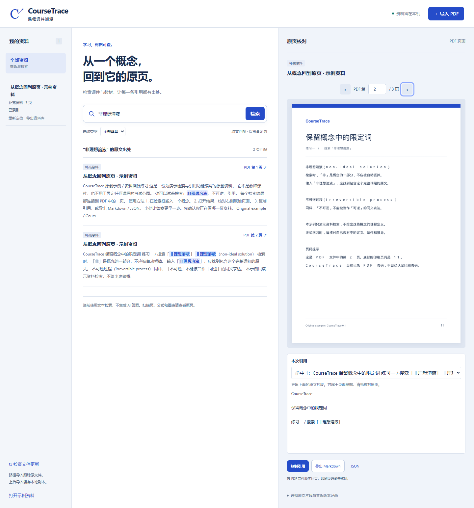

# CourseTrace

**从一个概念，回到它的原页。** 一个本地运行的课程 PDF 检索与出处核对工具。

状态：**v0.1.0-alpha.1，源码预览版**。首发面向 Windows 个人资料库，尚未验证大规模资料库性能。

CourseTrace is a local-first PDF source tracing tool for course materials. Search original text, inspect the source page, and export selected passages with page numbers and SHA-256 version records. No AI service or API key is required.



## 启动

Windows 安装 Python 3.10+（建议使用已验证的 Python 3.13），解压整个源码包后双击 `启动 CourseTrace.bat`（或 `start.bat`）。浏览器会自动打开本机地址；默认端口 8765 被占用时自动换用其他端口。
保持启动窗口运行；关闭窗口或按 Ctrl+C 停止服务。已有同一项目服务时，启动器会复用它。

这是需要 Python 的源码包。启动器首次运行会创建独立环境并联网安装依赖，兼容 `py` 和 `python` 命令；此后使用功能不需要网络或 API 密钥。macOS / Linux 的手动启动方式尚未在本次发布中实测。

跨平台手动启动：

```sh
python -m venv .venv
# Windows: .venv\Scripts\activate
# macOS / Linux: source .venv/bin/activate
python -m pip install -r requirements.txt
python app.py
```

## 三分钟体验

1. 点击「打开示例资料」，尝试搜索「非理想溶液」。
2. 打开命中结果，查看 PDF 第 2 页。原页底部写的是 11，用来演示 PDF 页序与印刷页码的区别。
3. 核对「本次引用的片段」，可切换同页命中，或展开提取文本手动选段。然后复制引用或导出 Markdown / JSON。直接翻阅页面时默认只记录页级出处，不附正文。
4. 导入自己的 PDF，选择「教师课件」「教材」或「补充资料」。来源类型由用户标记，不代表官方或教师认证。

## 已实现

- 上传 PDF 副本，或输入本地 PDF 路径并跟踪原文件。
- 逐页文本提取、中文/英文原文检索；支持来源类型与单资料筛选。
- 检索忽略大小写、全半角及空白差异，不去掉「非」「不」等否定词，不扩展同义词。
- PDF 原页预览与翻页，显示对应提取文本。
- 命中片段预览、同页多处命中切换、手动选段；服务端按当前文件版本与字符范围重新取文。
- 文件 SHA-256、索引时间与 PDF 页码写入引用；印刷页码保留为未核对。
- 检查文件更新；变化、缺失或不可读取的文件不参与检索，旧版页面不能导出引用。
- 上传副本可替换；路径资料可重建索引或重新定位，内容不同需确认更新。
- 导入显示解析进度并可取消；解析在独立进程中执行，超时退出不提交索引。
- 扫描页无文本时有明确提示，仍可浏览原页。

## 导入与存储

| 方式 | 文件位置 | 如何更新 |
|---|---|---|
| 上传 PDF | 副本保存在 `data/files/` | 点击「替换副本」 |
| 跟踪本地原文件 | 保持在原路径 | 修改后「检查文件更新」→「更新索引」 |

网页选择文件无法获取原始绝对路径，因此上传副本不会自动跟踪你电脑上另一份原始文件。
所有索引保存在 `data/library.sqlite3`，不会上传到外部服务。服务只绑定本机回环地址。
移出资料库只删除索引记录，原文件和导入副本均保留。若要备份，可备份整个项目的 `data/`；路径导入的原文件需另外备份。

关闭程序后可以移动整个项目；上传副本采用相对路径。移动后若旧 `.venv` 无法启动，仅删除项目内的 `.venv` 并重新运行启动器。外部文件移动后使用「重新定位」。旧版本数据库首次打开前自动备份到 `data/backups/`，升级与回滚步骤见 [发布说明](docs/RELEASE_NOTES.md)。

自动状态检查发生在启动加载、刷新资料库、检索、打开页面和导出引用时；不包含后台文件监视器。

## 明确的边界

- 支持 PDF；暂不支持直接读取 PPTX、DOCX、图片或 OCR。PPT 可先导出为 PDF。
- 最大单文件 50 MB、2000 页；一次最多展示 200 个命中页面、每页最多 100 处命中；单次自选引用最多 10000 个字符。
- 使用字面原文匹配，不做语义检索、不生成 AI 答案。中文自然语言问题不一定能匹配书中措辞。
- 自动提取不保证还原复杂表格、数学公式、上下标。原页是核对依据，提取片段不是已验证引文。
- 哈希验证文件版本，不验证知识正确性或资料权威性。
- 搜索会读取候选资料以检查哈希；单资料筛选只检查选中资料。大型资料库、翻页缓存仍需后续性能优化。
- PDF 单次处理限时 120 秒；过大的复杂文档可拆分后重试。网络请求体有 10 秒无数据超时和 30 秒总时限。
- 后台导入最多并行 2 个、活动任务最多 8 个；提交阶段不能取消。适合单用户本地使用，不作为公网服务部署。
- 复制引用需浏览器允许剪贴板；不允许时可导出 Markdown。

## 开发与验证

```sh
python -m unittest discover -s tests -v
python -m pip install -r requirements-dev.txt
python tests/browser_check.py
```

浏览器检查默认使用本机 Microsoft Edge。也可以安装 Playwright Chromium 并设置 `COURSETRACE_BROWSER=chromium`，CI 使用后者。检查使用独立临时资料库，不会修改用户的 `data/`。
项目结构、下一阶段计划见 `docs/PROJECT_PLAN.md`；当前验收结果见 `docs/VALIDATION.md`。

源码打包：`python scripts/build_release.py`。生成 ZIP、SHA-256 校验文件与逐文件清单，排除环境、个人资料和工作日志。

## 故障排查与反馈

- 提示找不到 Python：安装 Python 3.10+，启用 PATH 或 Python Launcher 后重试。
- 首次安装失败：检查联网与启动窗口中的 pip 错误，再次启动会重试。
- 显示原文件变化或失联：使用「更新索引」或「重新定位」，不要继续引用旧版本。
- 扫描件搜不到：当前没有 OCR，可查看原页；暂时只支持文本型 PDF 检索。
- 处理超时：拆分 PDF 后重试；提交前取消不会增加半条资料记录。

遇到问题可使用本仓库 Issues 的缺陷模板。请提供版本、Python/Windows 版本、复现步骤和可公开的最小样例；不要上传私人课件、教材或个人资料库。

## 开源与资料授权

代码采用 **AGPL-3.0-or-later**，使用 PyMuPDF（AGPL 许可版本）进行 PDF 解析和渲染。详见 `LICENSE` 与 `THIRD_PARTY_NOTICES.md`。
原创示例随项目发布。用户教材、教师课件和私人资料不属于项目发行内容。
`.gitignore` 排除本地资料、索引、环境和测试临时文件；公开仓库前仍需检查提交清单。

开源发布不代表任何资助或会员申请已获批准。项目不承诺此类资格。
